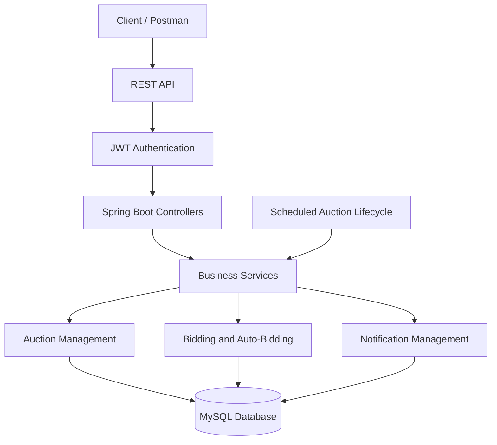
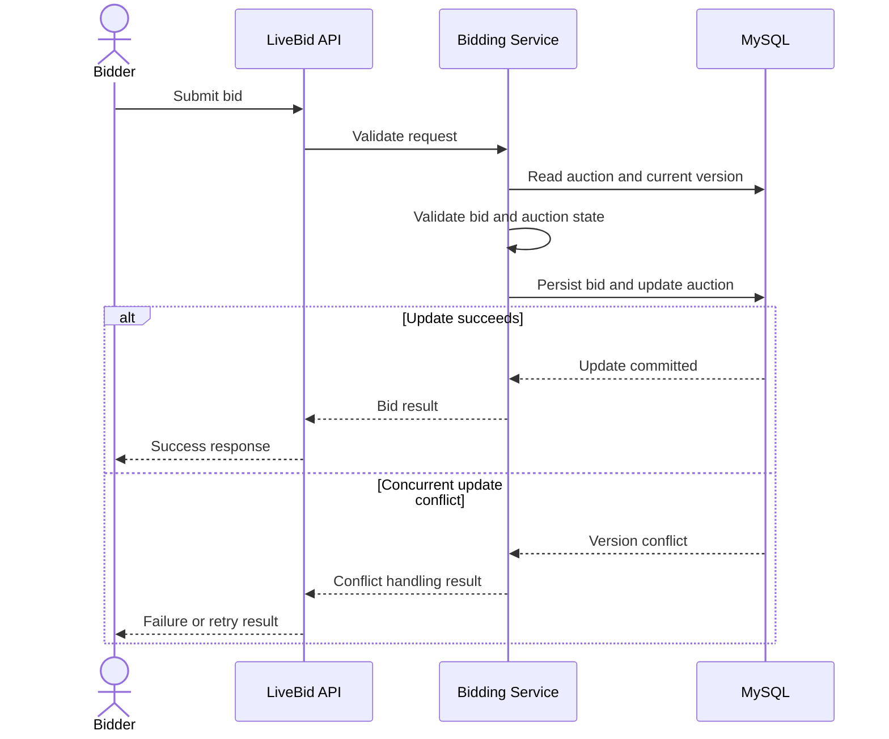

# 🔨 LiveBid — Online Auction System

<p align="center">
  <strong>A Java-based online auction backend with secure authentication, competitive bidding, automatic bidding, and real-time auction lifecycle management.</strong>
</p>

<p align="center">
  
  
  
  
  
</p>

<p align="center">
  <a href="#-overview">Overview</a> •
  <a href="#-features">Features</a> •
  <a href="#-architecture">Architecture</a> •
  <a href="#-api-reference">API Reference</a> •
  <a href="#-getting-started">Getting Started</a> •
  <a href="#-testing">Testing</a>
</p>

---

## 📌 Overview

**LiveBid** is a backend application for managing online auctions. It provides authenticated users with APIs to browse auctions, place bids, configure automatic bidding, and retrieve notifications.

The system also handles auction lifecycle transitions and uses optimistic locking to help prevent conflicting updates during concurrent bidding.

### 🎯 Project Objectives

- Build a structured Java backend for an online auction platform.
- Implement secure, token-based authentication.
- Maintain bid consistency when multiple users compete.
- Automate bidding within user-defined limits.
- Manage auction closure and winner notifications.

## ✨ Features

<details>
<summary><strong>🔐 Authentication and Security</strong></summary>

- User registration and login APIs.
- JWT-based authentication for protected endpoints.
- Password hashing using BCrypt.
- Authenticated requests for user-specific operations.

</details>

<details>
<summary><strong>🔨 Auction Management</strong></summary>

- Retrieve the list of auctions.
- Retrieve an individual auction by ID.
- Create auctions.
- Track the auction's current highest bid and bidder.
- Manage scheduled, live, and closed auction states.

</details>

<details>
<summary><strong>💰 Bidding and Concurrency</strong></summary>

- Submit bids against an auction.
- Retrieve an auction's bid history.
- Track the highest bid.
- Use optimistic locking to detect conflicting concurrent updates.

**Why concurrency matters:** When multiple users attempt to bid simultaneously, the backend must protect the auction's current state from conflicting updates.

</details>

<details>
<summary><strong>🤖 Automatic Bidding</strong></summary>

- Configure an automatic bidding limit.
- Allow the system to submit eligible bids on behalf of a user.
- Deactivate a user's automatic bidding configuration.
- Track whether a bid was placed manually or automatically.

</details>

<details>
<summary><strong>🔔 Notifications and Auction Lifecycle</strong></summary>

- Retrieve notifications for the authenticated user.
- Generate outbid notifications.
- Notify the winning bidder when an auction closes.
- Periodically evaluate scheduled and live auctions.

</details>

## 🏗️ Architecture



### Technology Stack

| Technology | Purpose |
|---|---|
| Java 21 | Core programming language |
| Spring Boot | Backend application framework |
| Spring Security | Endpoint protection |
| JWT | Token-based authentication |
| BCrypt | Password hashing |
| MySQL | Relational database |
| Spring Data JPA | Database persistence |
| JDBC | Database access where implemented |
| Postman | API testing |
| IntelliJ IDEA | Development environment |

## 🔄 How Bidding Works



*The diagram illustrates the intended bidding flow. Exact retry behavior and transaction boundaries depend on the implementation.*

## 🔌 API Reference

**Base URL:** `http://localhost:8080`

### Authentication

| Method | Endpoint | Purpose |
|---|---|---|
| `POST` | `/api/auth/register` | Register a user |
| `POST` | `/api/auth/login` | Authenticate a user |

### Auctions and Bids

| Method | Endpoint | Purpose |
|---|---|---|
| `GET` | `/api/auctions` | List auctions |
| `GET` | `/api/auctions/{id}` | Get auction details |
| `POST` | `/api/auctions` | Create an auction |
| `POST` | `/api/auctions/{auctionId}/bids` | Place a bid |
| `GET` | `/api/auctions/{auctionId}/bids` | Retrieve bid history |

### Automatic Bidding

| Method | Endpoint | Purpose |
|---|---|---|
| `POST` | `/api/auctions/{auctionId}/auto-bid` | Configure automatic bidding |
| `DELETE` | `/api/auctions/{auctionId}/auto-bid` | Deactivate automatic bidding |

### Notifications

| Method | Endpoint | Purpose |
|---|---|---|
| `GET` | `/api/users/me/notifications` | Retrieve notifications for the authenticated user |

<details>
<summary><strong>📨 Example: Place a Bid</strong></summary>

**Request**

```http
POST /api/auctions/9/bids
Authorization: Bearer YOUR_JWT_TOKEN
Content-Type: application/json
```

Use the bid request JSON expected by your application's request DTO.

**Expected workflow**

1. Authenticate and obtain a JWT.
2. Select an auction that is accepting bids.
3. Submit a valid bid using the authenticated user's token.
4. Verify the result using the auction details and bid-history endpoints.

</details>

<details>
<summary><strong>🤖 Example: Configure Automatic Bidding</strong></summary>

**Request**

```http
POST /api/auctions/9/auto-bid
Authorization: Bearer YOUR_JWT_TOKEN
Content-Type: application/json
```

**Request body**

```json
{
  "maxAmount": 4000.00
}
```

The maximum amount represents the user's configured automatic bidding limit. The actual bidding rules depend on the auction and service implementation.

</details>

<details>
<summary><strong>🔔 Example: Retrieve Notifications</strong></summary>

**Request**

```http
GET /api/users/me/notifications
Authorization: Bearer YOUR_JWT_TOKEN
```

The endpoint retrieves notifications for the authenticated user rather than accepting an arbitrary user ID in the URL.

</details>

## 🚀 Getting Started

### Prerequisites

- Java Development Kit (JDK) 21
- MySQL Server
- IntelliJ IDEA or another Java IDE
- Git
- Postman (for API testing)

### 1. Clone the Repository

```bash
git clone https://github.com/sujithakrishna/livebid-auction-system.git
cd livebid-auction-system
```

### 2. Create the Database

Open MySQL Workbench or your MySQL client and execute:

```sql
CREATE DATABASE livebid_db;
```

Ensure the database tables are created using the project's entity mappings or database initialization configuration.

### 3. Configure Database Credentials

Update the database configuration in your application's configuration file.

Example for `application.properties`:

```properties
spring.datasource.url=jdbc:mysql://localhost:3306/livebid_db
spring.datasource.username=${DB_USERNAME}
spring.datasource.password=${DB_PASSWORD}
```

Configure the remaining application properties according to your project.

**Security:** Keep database credentials, JWT secrets, and other private configuration out of GitHub. Use environment variables or a local, Git-ignored configuration file.

### 4. Run the Application

Open the project in your IDE, ensure the required dependencies are resolved, and run the Spring Boot application.

The default local API base URL is:

```text
http://localhost:8080
```

### 5. Test Using Postman

1. Register a user.
2. Log in and obtain a JWT.
3. Add the token as a Bearer Token for protected endpoints.
4. Create or select an auction.
5. Place bids and inspect the bid history.
6. Test automatic bidding and notifications.

## 🧪 Testing Checklist

Use this checklist as a guide when verifying the application.

- [ ] User registration and login
- [ ] JWT authentication for protected endpoints
- [ ] Auction creation and retrieval
- [ ] Valid and invalid bid requests
- [ ] Bid history retrieval
- [ ] Concurrent bidding and optimistic-lock conflict handling
- [ ] Automatic bidding within the configured limit
- [ ] Automatic bidding deactivation and ownership validation
- [ ] User-specific notification retrieval
- [ ] Scheduled auction transitions and winner notifications

## 📂 Project Structure

The project follows a Spring Boot application structure. The exact package and class names should be verified against the repository.

```text
livebid-auction-system/
├── src/
│   ├── main/
│   │   ├── java/
│   │   │   └── com/sujitha/livebidspringboot/
│   │   └── resources/
│   └── test/
├── pom.xml
└── README.md
```

## 💡 Engineering Highlights

- **Concurrency control:** Optimistic locking helps detect competing updates to an auction.
- **Authentication:** JWT provides an authenticated identity for protected API requests.
- **Automated workflows:** Scheduled processing manages auction state transitions.
- **Automated bidding:** User-defined limits support automatic bid placement.
- **Data isolation:** The notification API scopes results to the authenticated user.

## 🛣️ Future Improvements

- Add a dedicated automated test suite for bidding and concurrency.
- Add integration tests for authentication, authorization, and auction lifecycle transitions.
- Document request and response schemas for every endpoint.
- Add API documentation using OpenAPI/Swagger if configured.
- Add deployment instructions and production monitoring.
- Add a frontend for bidders and auction administrators.

## 👩‍💻 Author

**Sujitha V K**

- GitHub: [@sujithakrishna](https://github.com/sujithakrishna)
- LinkedIn: [Connect on LinkedIn](https://www.linkedin.com/in/sujitha-v-k-77a924258/)

---

<p align="center">
  <strong>LiveBid — Building reliable bidding workflows with Java.</strong>
</p>
